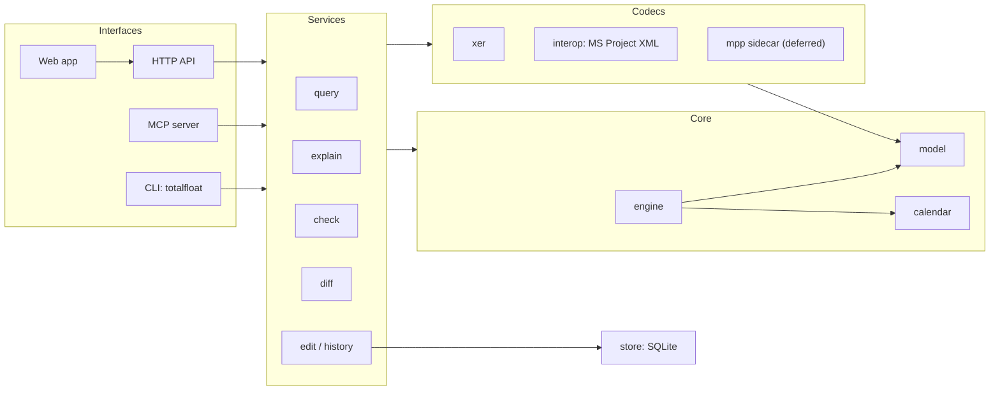

# Architecture

How TotalFloat is built, and why. The [design decisions](#design-decisions) below are settled: change one by opening an issue first ([CONTRIBUTING.md](../CONTRIBUTING.md#proposing-a-design-change)). Sections marked *(planned)* are not built yet.

## Design decisions

| Decision | In short |
|---|---|
| [Rust core](#rust-core) | The core and CLI are Rust, with no unsafe code. |
| [License and dependencies](#license-and-dependencies) | Apache-2.0, DCO sign-off, permissive dependencies only. |
| [Lossless round trips](#lossless-round-trips) | A file opened and saved changes only where it was edited. |
| [The schedule model](#data-model) | Common CPM concepts and integer-minute civil time. |
| [Deterministic engine](#deterministic-engine) | Every computed value comes from pure engine functions. |
| [Bring your own agent](#bring-your-own-agent) | CLI and MCP first; the core never calls a model or the network. |
| [One binary](#one-binary) | One executable for files, a local app and, later, a team server. |
| [File interop](#file-interop) | Other formats are translated in and out of TotalFloat's own model and rules. |
| [Scheduling rules](#scheduling-rules) | TotalFloat's own written rules, each with public sources. |
| [History as changesets](#history-and-changesets) | Every edit is a recorded, reversible command. |
| [Local app](#local-app) | A browser app served by the binary, on loopback only. |
| [Schedule as text](#schedule-as-text) | A line-based text format that compiles to edit commands. |

## Overview

Every interface (CLI, MCP, HTTP, UI) calls the same service layer. Nothing is possible only through one interface.

## Crates

All crates live under `crates/` and publish as `totalfloat-<name>`.

| Crate | Responsibility | May depend on |
|---|---|---|
| `model` | Canonical schedule model, IDs, enums, schedule options. No I/O. | — |
| `calendar` | Work-time arithmetic: add/subtract work minutes, count work between instants, exceptions. | `model` |
| `xer` | XER codec: raw lossless layer, field registry, typed tables, model mapping, patch writer, fresh writer. | `model` |
| `engine` | CPM scheduling: forward/backward pass, float, constraints, progress, critical/longest path, provenance. Pure functions. | `model`, `calendar` |
| `check` | Schedule quality checks (DCMA 14-point and more). | `model`, `engine` |
| `diff` | Semantic comparison of two schedules. | `model` |
| `edit` | Typed edits to a schedule, each applied or refused with a reason. Pure functions. | `model`, `calendar` |
| `evm` | Earned value from a schedule's progress, costs and plan. Pure functions. | `model` |
| `risk` | Monte Carlo schedule risk: three-point estimates and correlation sampled into the engine, with the finish distribution, criticality and sensitivity. Pure functions. | `model`, `engine` |
| `interop` | Other schedule formats: MS Project XML in, with a report of what didn't translate. Pure functions. | `model` |
| `text` | The schedule text format (`.tfs`, [Schedule as text](#schedule-as-text)): reader with line-and-column diagnostics, and the canonical formatter. Pure functions. | `model`, `edit` |
| `store` | History store: changesets, refs, compressed file snapshots, integrity and ancestry, in one SQLite file. Knows nothing about schedules. | — |
| `server` | HTTP shell for the [local app](#local-app): loopback only, session token and cookie, host and origin checks, security headers, static assets, server-sent events. Knows nothing about schedules; the caller adds the API routes. | — |
| `cli` | The `totalfloat` binary, including the `mcp` subcommand. | everything |
| `xtask` (top level) | Dev tooling: corpus management, fixtures, release helpers. | everything |

Rules:
- `model`, `calendar` and `engine` never do I/O and never depend on codecs.
- Codecs never schedule. They read and write what the file says.
- Only `cli`/`xtask` may touch the filesystem, environment or process. The exception is `store`, which reads and writes its own database file and nothing else.

## Rust core

The core (codecs, calendar math, CPM engine) has to be fast on 100,000-activity schedules, safe on untrusted files, deterministic, and runnable as a CLI, a server and, later, in the browser. So the core and the CLI are written in Rust (stable, edition 2024), with `#![forbid(unsafe_code)]` in every crate. One codebase gives single static binaries on Linux, macOS and Windows, and WebAssembly when the app needs in-browser previews. Fewer people know Rust than Java, Python or TypeScript, so the docs, small crates and well-specified issues have to make up for it.

## License and dependencies

TotalFloat is free, and companies must be able to adopt it and build on it.

- The project is licensed under Apache-2.0, which is permissive and grants patents explicitly.
- Contributors sign off commits under the Developer Certificate of Origin (`git commit -s`). There is no CLA.
- Rust and npm dependencies must be permissively licensed (MIT, Apache-2.0, BSD, ISC, Zlib, Unicode, and MPL-2.0 for unmodified use). `cargo deny` and `cargo xtask ui --licenses` enforce this in CI.
- Copyleft components, such as MPXJ (LGPL), may only ever be separate, optional tools run out of process, never linked into the core.

## Data model

TotalFloat has one canonical model, and every format maps into it.

- **Common scheduling concepts.** Activity types, duration types, percent-complete types, constraint types, relationship types, calendars and schedule options follow the conventions CPM scheduling tools share. Model fields document the file fields they map to. What a calculation does with them is decided by the [scheduling rules](#scheduling-rules).
- **Time:** civil datetimes (no time zones) at minute resolution. Durations, lags and float are integer minutes, so no rounding error builds up. Conversions to decimal-hour fields happen only in codecs. Files whose values need sub-minute precision would reopen this decision.
- **Identity:** every entity keeps its IDs from the source file so round trips and re-imports match up. New entities get IDs above the file's maximum.
- **Provenance link:** model entities keep a reference to the raw row they came from, so the writer can patch instead of regenerate.
- **Extras:** fields the model doesn't understand ride along untouched.

## Lossless round trips

Users must be able to open a schedule file, change something, and hand back a file with nothing else changed. XER is the format TotalFloat works in: byte-identical XER round trips are a tested guarantee, and unknown tables and fields survive by construction. Other formats are translated in and out with a report of anything that didn't carry over ([File interop](#file-interop)).

The XER codec has three layers:

1. **Raw:** `ERMHDR` header plus tables (`%T` name, `%F` fields, `%R` rows, `%E` end) kept as original bytes, with the detected encoding and line endings. `read → write` is byte-identical.
2. **Typed:** a field registry (table and field names, value kinds, enums, version notes) decodes known tables into Rust structs; unknown tables and fields remain raw. Problems become diagnostics, never panics.
3. **Model mapping:** typed tables ↔ model.

Two writers:
- **Patch writer:** start from the original raw layer; rewrite only cells whose model values changed; append new rows; remove deleted rows. Unchanged rows stay byte-identical.
- **Fresh writer:** produce a complete XER from a model with no source file, for test fixtures and schedules built from scratch.

## Engine

- `schedule(&Schedule, &ScheduleOptions) -> Result<ScheduleResult, EngineError>` is a pure, deterministic function. The data date comes from the project.
- Implements the scheduling options a file holds ([TF-008](rules/TF-008-xer-schedule-options.md)) and reports early/late dates, remaining early/late dates, total and free float, critical flag, driving relationships, float paths.
- **Provenance:** for every computed date the engine records what controlled it: driving predecessor and relationship (with lag and lag calendar), constraint, data date, actual date, or calendar adjustment. `explain` renders this. Provenance is part of the result, not a debug feature.
- Cycles are reported with the full loop, not just "cycle detected".
- Resource leveling is *(planned)*; Monte Carlo risk is the `risk` crate, on the same model.

## Deterministic engine

Schedules are contractual and evidentiary. Language models are good at proposing, explaining and drafting, and unreliable at arithmetic over large networks. So every computed value (dates, float, critical and driving paths, earned value, checks) comes from deterministic, pure engine functions. Agents read results and propose edits through the same commands people use, and never write computed values themselves. The engine records provenance for every computed date, so a result can be explained without a model. Results are reproducible and testable.

## Scheduling rules

TotalFloat defines its own scheduling rules. Each calculation rule is written in its own words in [`docs/rules/`](rules/README.md), with its sources, and is TotalFloat's rule. Where reasonable schedulers differ, the choice is a named scheduling option: a file's own setting selects it where the file holds one, and otherwise a documented default applies. Edge cases that no public source settles become options or clear refusals. [CONTRIBUTING.md](../CONTRIBUTING.md#calculation-rules-and-their-sources) says which sources a rule may rest on.

Rules are verified with tests written from each rule, property tests of invariants, and comparisons with open-source schedulers we're free to run.

## File interop

Every format is translated in and out of TotalFloat's model and calculated by TotalFloat's own rules. MS Project XML files can hold things TotalFloat's model doesn't (effort-driven tasks, logic on summary tasks, manually scheduled tasks), so:

- MS Project XML is imported and exported natively, with a report of everything that didn't translate. `.mpp` may come later through an optional out-of-process MPXJ sidecar.
- MS Project-specific fields survive a round trip where the format allows.
- Dates TotalFloat calculates for an imported file can differ from the ones the file holds, and the import report says so.
- The engine's rule set stays internally swappable, without a second rule set until there's clear demand for one.

## History and changesets

Agent edits to contractual schedules must be attributable, reviewable and reversible, and forensic analysis needs the edits between updates, not just the monthly exports. Users choose how to keep history, and all three ways stay supported: plain files (`edit` writes a new file and records nothing), git (with `totalfloat textconv` for readable diffs of any XER), or the history store.

- Every edit is a typed command (`AddActivity`, `SetDuration`, `AddRelationship`, …), one change each, as JSON under the versioned schema `totalfloat.command/1` in `docs/schemas/`. A released version's meaning never changes.
- A batch is all or nothing by default and reports every refusal in one pass, with its position, reason and hint; commands that depend on a refused one are reported as depending on it. `--skip-failed` is opt-in. Risky but valid edits are warnings unless `--check` asks to block on them.
- A store is one SQLite file (`<name>.tfdb`) per schedule file, compiled into the binary. A changeset has a content hash ID, its parents, a kind (`import`, `edit`, `revert` or `merge`), an author and whether it's a person or an agent, a reason, a time, the TotalFloat version, its commands, any skipped commands, its edit report, and the resulting file, compressed and content-addressed.
- Branches are named refs for what-ifs; baselines are refs that never move; proposals wait for a person to accept or reject them. A branch moves only forward, and only from where its writer last read it.
- Undo and revert add a changeset; nothing is deleted. Replay recalculates from commands for reverts, merges and proposals, and `history verify --replay` reports where replaying today gives a different file.
- Merging replays the other branch's edits and is refused, with the conflicts listed, when a command can't apply or both sides changed the same field to different values.
- Computed results always come from the engine, never from the history. Any point exports as an ordinary XER.
- The `store` crate knows nothing about schedules, and its API exposes no SQLite types, so a Postgres backend can sit behind the same calls.

## Interfaces

### CLI conventions (agent-first)

- Every command supports `--json` with a stable, versioned schema; human-readable output is the default. Published schemas live in `docs/schemas/`, and tests check the output against them.
- No interactive prompts. Stable exit codes: `0` ok, `1` error, `2` usage, `3` validation findings.
- Edits support `--dry-run`, which shows the change and its schedule impact.
- Errors carry a code, message and hint, so an agent can act on them.

### MCP server

- `totalfloat mcp` serves MCP over stdio.
- Tools mirror CLI commands. Opened schedules are referenced by a session handle, so large files aren't re-sent.
- Results are paged and summarized by default. A 50k-activity schedule must never be dumped into a model's context. Agents query, filter and trace instead.

## Bring your own agent

Companies must approve which AI providers touch their data, and agent ecosystems change quickly. So TotalFloat exposes everything through a CLI with stable JSON output and an MCP server, and users connect whatever agent they're allowed to use. The core never calls a model and makes no network calls, so it works air-gapped with local models. Tool design (granularity, paging, error messages, explain output) is product surface and is tested like it. An optional chat panel with user-configured providers may come later.

## Local app

`totalfloat serve` runs a browser app from the same binary: an activity grid, a Gantt chart, the explain panel, and review of branches and agent proposals. One app serves local use now and a team server later.

- **Loopback only.** It listens on `127.0.0.1`. Each run makes a random token, which the page exchanges for an `HttpOnly`, `SameSite=Strict` cookie that every API call needs. Requests with another `Host` are refused (no DNS rebinding), changing requests from another `Origin` are refused, there are no CORS headers, and a content security policy allows only the app's own scripts and styles.
- **One write path.** The HTTP API (`/api/1/…`) is the same service layer the CLI and MCP use, speaking the published schemas. Every change goes through the history store as a changeset with the person as author. Server-sent events push new changesets and proposals to open pages, so an agent's MCP edit shows up in the grid within a second.
- **Fast at 50,000 activities.** The grid and Gantt are drawn on a canvas from a shared row model, so only the rows on screen are drawn. Editing a cell opens an ordinary input over it, for typing, IME input and screen readers.
- **Keyboard-first.** Every action has a key and a command palette entry, and the grid moves and edits like a spreadsheet.
- **Nothing fetched at run time.** The built front end (TypeScript, React, Vite, in `ui/`) is compiled into the binary, with fonts and icons bundled. A Rust-only build serves a page saying how to build the app.
- **Recalculation on the server.** The server's engine produces every recorded result. In-browser previews through WebAssembly come only when measurements show the round trip is noticeable, and a preview never becomes a recorded result.

## Schedule as text

A schedule can be written as a `.tfs` text file that agents write with ordinary file tools and people read and diff, one activity per line ([guide](guide/text.md)). It's a front end to the edit commands, with no second write path: applying a text file turns each difference into an edit command, checked, recorded and calculated like any other.

- One statement per line, indented details under it, logic on the successor (`after A1020 ss+2d`), a `totalfloat-schedule 1` version line whose meaning never changes once released.
- The file holds what a planner decides (durations, logic, constraints, calendars, progress), never calculated dates or float.
- Errors give the file, line and column, underline the text, and suggest a fix, every problem in one pass.
- `--apply` refuses to delete what a file leaves out until the user picks `--delete-missing` or `--keep-missing`.
- The `text` crate has a hand-written parser, for the best errors and recovery. YAML, TOML and JSON spread one activity over many lines, and an embedded programming language would make a schedule a program that has to run to be read.

## One binary

With no company behind it, TotalFloat has to be trivial to run and credible to self-host. It ships as one binary, with the same engine and schema in every mode, and no message queues or microservices: the engine is fast enough to recalculate in process.

| Mode | How | Storage |
|---|---|---|
| Files | `totalfloat <command> file.xer`, `totalfloat mcp` | Files only |
| Local | `totalfloat serve` on localhost | SQLite history stores |
| Team *(planned)* | `totalfloat serve` with Postgres, sign-in and roles | Postgres |

## Cross-cutting concerns

- **Untrusted input:** schedule files are untrusted. Parsers are fuzzed and must not panic; limits are enforced on sizes and nesting.
- **Performance budgets:** schedule 100k activities / 150k relationships in < 1 s (release build, laptop). Benchmarks with `criterion` guard this.
- **Determinism:** ordered maps for output, stable sorting, no ambient time.
- **Testing layers:** unit → property (codecs, calendar math) → snapshot (CLI) → fixture (synthetic XERs) → corpus (real public files, downloaded by `cargo xtask corpus fetch`, read, edited and written back) → fuzz.
